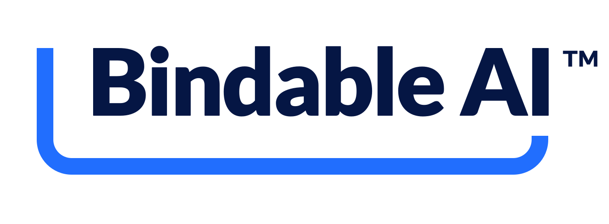

<picture>
  <source media="(prefers-color-scheme: dark)" srcset="./assets/bindable-logotype-white-blue-tm-transparent.svg">
  <source media="(prefers-color-scheme: light)" srcset="./assets/bindable-logotype-preferred-navy-blue-tm-transparent.svg">
  
</picture>

Bindable makes AI agents accountable so teams can delegate more to AI with confidence.

We’re in beta and inviting teams building, deploying, or governing agentic systems to help shape Bindable.

## Explore

- [Bindable Gate](https://github.com/bindable-ai/gate) — Our public repository. See its README for what’s available and how to use it.
- [Request beta access](https://www.bindable-ai.com/request-access) — Tell us what you’re building or exploring.

[Learn more about Bindable](https://www.bindable-ai.com/)
